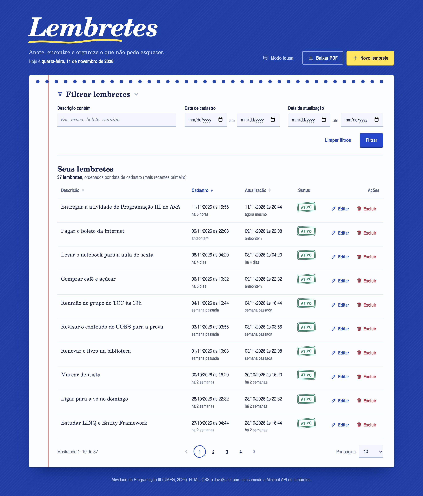
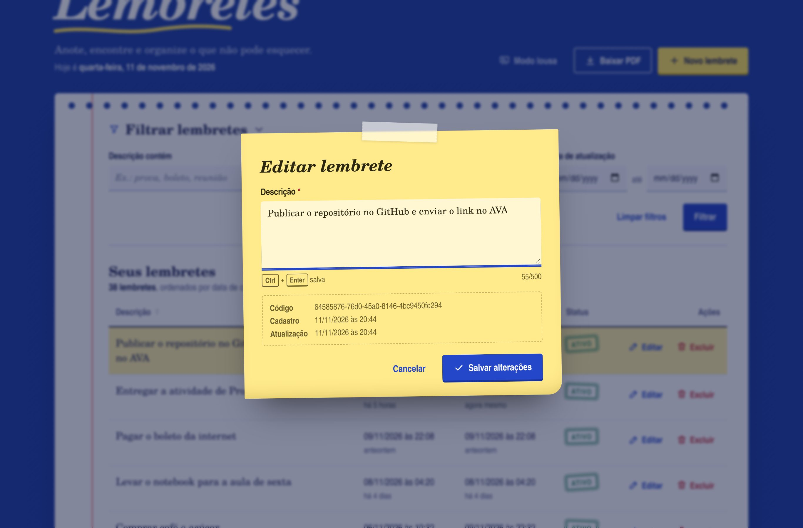
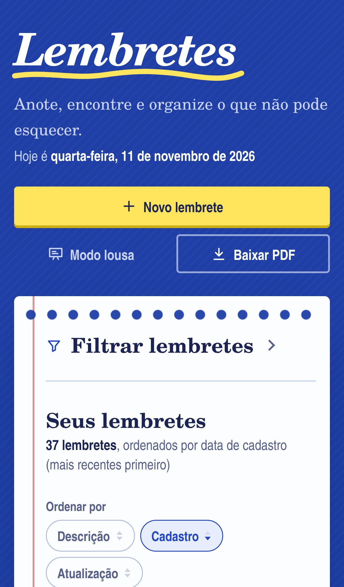
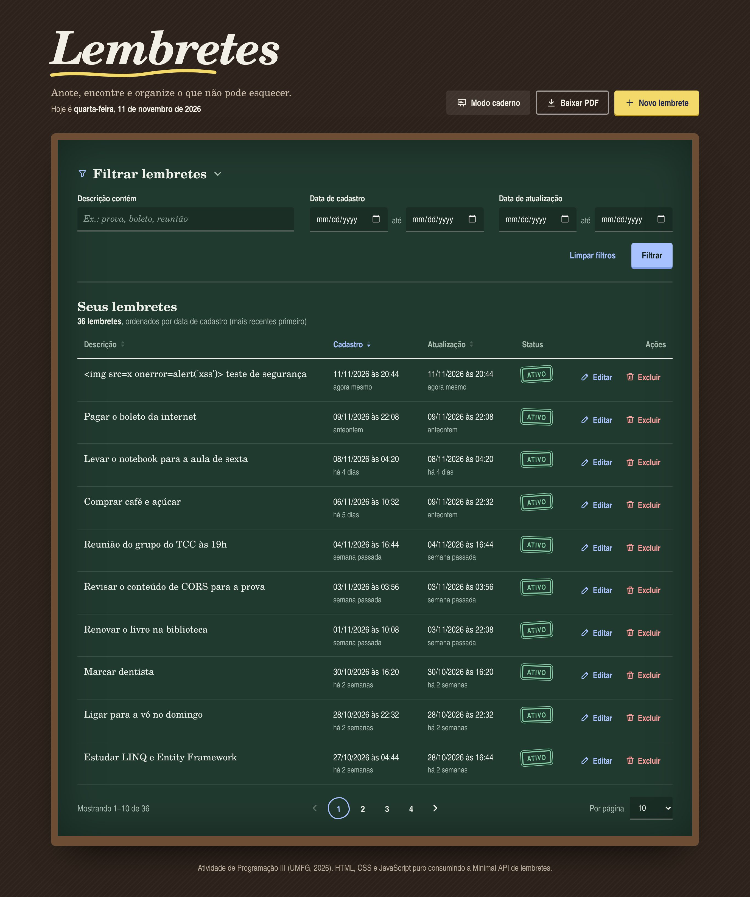
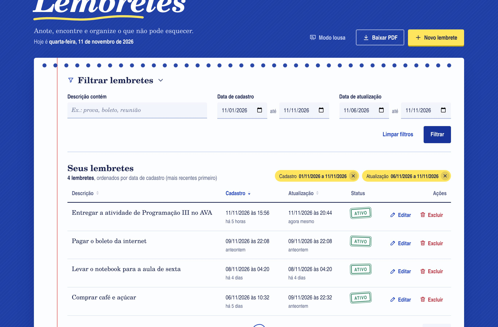
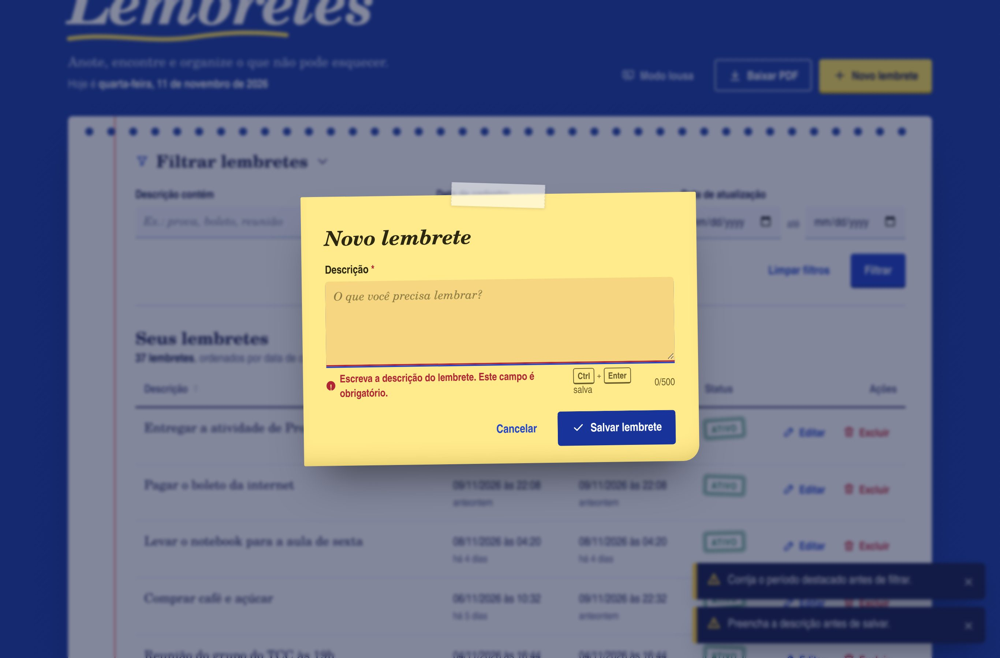
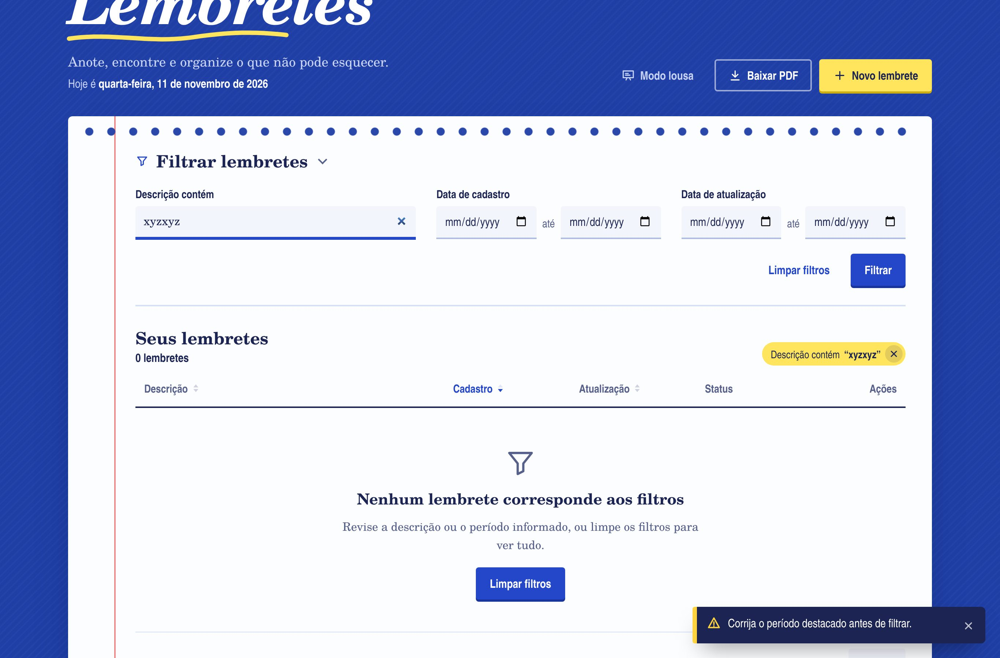
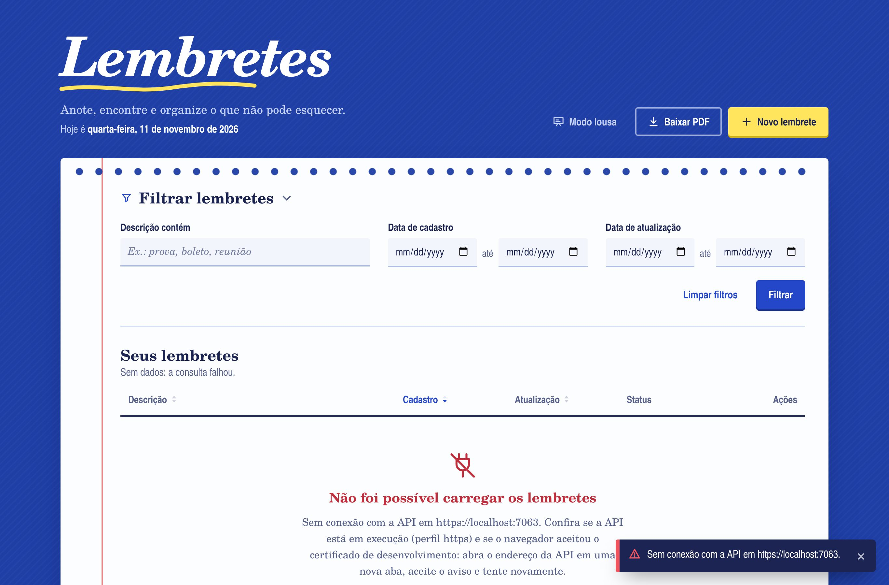

# Lembretes — Programação III (UMFG 2026)

Front-end em **HTML, CSS e JavaScript puro** que consome a **Minimal API de lembretes** (.NET 8 + Entity Framework Core + MySQL) fornecida pelo professor. Implementa cadastro, consulta, edição e exclusão, todos os filtros da API, paginação, ordenação pelo cabeçalho da tabela e mensagens de erro e sucesso.



## Estrutura do repositório

```
api/                       Minimal API do professor (com as correções descritas abaixo)
  umfg.programacaoiii.minimalapi.2026/
    Program.cs             endpoints, CORS e filtro/paginação/ordenação
    DTO/LembreteQueryDTO.cs parâmetros aceitos por /lembretes/filtro
    *.http                 todas as requisições da atividade, prontas para testar
front-end/
  index.html               estrutura da página (filtros, tabela, paginação, diálogos)
  css/style.css            identidade visual, temas claro/escuro e responsividade
  js/app.js                comunicação com a API, renderização e regras da tela
  fonts/                   fontes locais (TeX Gyre, licença GUST): funciona sem internet
docs/img/                  capturas de tela
```

## Como executar

### 1. API

Pré-requisitos: **.NET 8 SDK** e **MySQL 8**. A conexão fica em `appsettings.Development.json` (`localhost:3306`, usuário `root`, senha `root`); no laboratório da UMFG use o perfil `umfg` (porta 3308). As migrations são aplicadas sozinhas na primeira execução (construtor do `MySqlContexto`).

```bash
cd api/umfg.programacaoiii.minimalapi.2026
dotnet dev-certs https --trust        # confia no certificado HTTPS de desenvolvimento
dotnet run --launch-profile https     # API em https://localhost:7063
```

Abra `https://localhost:7063/lembretes` no navegador: deve aparecer um JSON (`[]` com o banco vazio). Isso também faz o navegador aceitar o certificado.

### 2. Front-end

Abra a pasta `front-end` no VS Code e use **Live Server** em `index.html` (abre em `http://127.0.0.1:5500`). Alternativa sem extensão:

```bash
cd front-end
python -m http.server 5500            # acesse http://localhost:5500
```

O endereço da API está na primeira constante de `js/app.js` (`API_URL`). Se a API rodar pelo perfil `http`, troque para `http://localhost:5207`.

---

## Etapa 1 — Como o projeto funciona

**Front-end.** O `index.html` só tem a estrutura; tudo o que muda na tela é criado pelo `app.js`. O fluxo é sempre o mesmo:

```
ação do usuário → função do app.js → chamarApi() → fetch() → API → JSON → renderização na tabela
```

Toda requisição passa pela função `chamarApi()`: ela monta a URL e a query string, define os headers (`Accept`, e `Content-Type: application/json` quando há corpo), converte o objeto em JSON com `JSON.stringify`, aplica tempo limite de 10 s com `AbortController`, registra a requisição no console e transforma falhas em mensagens legíveis. O estado da tela (página, tamanho da página, ordenação e filtros) fica no objeto `estado`.

**Endpoints da API**

| Método | Rota | Onde é usado no front-end | Respostas |
|---|---|---|---|
| `GET` | `/lembretes/filtro` | lista, filtros, paginação e ordenação | `200` `{ lembretes, total, numeroPagina, tamanhoPagina }` · `400` página inválida |
| `GET` | `/lembretes/{id}` | botão **Editar** (carrega o bilhete) | `200` lembrete · `404` |
| `POST` | `/lembretes` | **Novo lembrete** → **Salvar lembrete** | `201` lembrete criado |
| `PUT` | `/lembretes/{id}` | **Salvar alterações** | `200` lembrete atualizado · `404` |
| `DELETE` | `/lembretes/{id}` | **Excluir** → **Excluir lembrete** | `204` · `404` (exclusão lógica: `IsAtivo = false`) |
| `GET` | `/lembretes/imprimir` | **Baixar PDF** (mesmos parâmetros do filtro) | `200` `application/pdf` |
| `GET` | `/lembretes` | não usado na tela (lista todos os ativos; está no `.http`) | `200` lista |

## Etapa 2 — Testes das requisições HTTP

O arquivo `api/umfg.programacaoiii.minimalapi.2026/umfg.programacaoiii.minimalapi.2026.http` tem todas as operações em sequência (Visual Studio 2022 17.12+ ou extensão *REST Client* do VS Code): **POST** cadastra e guarda o `id` retornado; **GET** lista; **GET por ID** busca; **PUT** atualiza; **GET filtro** com paginação, ordenação e datas; **GET filtro** com erro 400 esperado; **GET imprimir**; **OPTIONS** simulando o preflight de CORS; **DELETE** exclui; e **GET por ID** após excluir (404 esperado).

## Etapa 3 — CORS

Uma **origem** é a combinação de protocolo + domínio + porta. O front-end roda em `http://127.0.0.1:5500` e a API em `https://localhost:7063`: protocolo, domínio e porta são diferentes, então são **origens diferentes**. Pela *Same-Origin Policy*, o navegador envia a requisição mas **não entrega a resposta ao JavaScript** se a API não autorizar aquela origem com o header `Access-Control-Allow-Origin`.

Na API isso é configurado em duas partes do `Program.cs`:

```csharp
builder.Services.AddCors(options =>
{
    options.AddPolicy("Frontend", policy =>
        policy.AllowAnyOrigin()    // Access-Control-Allow-Origin: *
              .AllowAnyHeader()    // aceita o header Content-Type: application/json
              .AllowAnyMethod());  // aceita PUT e DELETE no preflight
});
...
app.UseCors("Frontend");           // aplica a política a todas as respostas
```

- **Requisições simples** (`GET` com `Accept`) vão direto; a resposta só precisa trazer `Access-Control-Allow-Origin`.
- **POST e PUT** com `Content-Type: application/json` e **DELETE** (método "não simples") disparam antes um **preflight**: o navegador envia `OPTIONS` com `Origin`, `Access-Control-Request-Method` e `Access-Control-Request-Headers`, e só envia a requisição real se a API responder autorizando.
- CORS é uma regra **do navegador**: o arquivo `.http`, o Postman ou o `curl` não são bloqueados. Por isso uma requisição pode funcionar no `.http` e falhar na página.
- `AllowAnyOrigin()` é adequado para desenvolvimento. Em produção o correto é restringir: `.WithOrigins("https://app.empresa.com.br")`.

## Etapa 4 — Identidade visual

Conceito: **caderno escolar**. A página é a capa azul de um caderno e o conteúdo fica numa folha pautada, com a linha vermelha da margem e os furos do espiral. O formulário é um **bilhete amarelo colado com fita**, o termo pesquisado aparece **grifado de marca-texto**, o status é um **carimbo** (como o "visto" do professor) e a página atual da paginação aparece **circulada à caneta**. O botão **Modo lousa** troca para o tema escuro: a folha vira uma **lousa verde com moldura de madeira** (a escolha fica salva no navegador; na primeira visita segue a preferência do sistema).

| Token | Caderno | Lousa |
|---|---|---|
| Capa / fundo | `#1F3FA6` azul caneta | `#2E231C` madeira |
| Folha | `#FCFDFF` | `#213A30` verde lousa |
| Pauta / margem | `#D5E0F5` / `#EE8A8A` | giz translúcido |
| Tinta (texto) | `#1B2452` | `#EEF1E9` giz |
| Ação principal | `#2446C9` | `#A8C2FF` giz azul |
| Marca-texto / bilhete | `#FFE45E` / `#FFEA8C` | `#F3D86A` |

**Tipografia:** *TeX Gyre Schola* (versão livre da Century Schoolbook, a fonte clássica dos livros escolares) para títulos e textos, e *TeX Gyre Heros Condensed* para rótulos, botões, datas e números. Os arquivos ficam em `front-end/fonts`, então a página tem a mesma aparência sem internet.

**Responsividade:** abaixo de 760 px a tabela vira uma lista de fichas, o cabeçalho de ordenação vira botões em formato de pílula, os filtros começam recolhidos e os botões ocupam a largura da tela. Sem rolagem horizontal em 390 px.

**Acessibilidade:** foco visível em todos os controles, `aria-sort` nas colunas ordenadas, `aria-current` na página atual, diálogos nativos (`<dialog>`) com Esc e foco, avisos com `role="status"`/`role="alert"`, link "Pular para a lista" e animações desligadas quando o sistema pede menos movimento.

| Edição (bilhete) | Celular | Tema lousa |
|---|---|---|
|  |  |  |

## Etapas 5 e 6 — Filtros, paginação e ordenação

| Controle na tela | Parâmetro enviado em `/lembretes/filtro` |
|---|---|
| Descrição contém | `Descricao` |
| Data de cadastro (de / até) | `DataCadastroInicial` / `DataCadastroFinal` |
| Data de atualização (de / até) | `DataAtualizacaoInicial` / `DataAtualizacaoFinal` |
| Números de página, ‹ e › | `NumeroPagina` |
| Por página (5, 10, 20, 50) | `TamanhoPagina` |
| Clique no título da coluna | `Ordem` (`Descricao`, `DataCadastro`, `DataAtualizacao`) e `Direcao` (`ASC`/`DESC`) |

- **Filtros:** aplicados com **Filtrar** ou Enter. Cada filtro ativo aparece como etiqueta amarela acima da tabela e pode ser removido no "×"; **Limpar filtros** remove todos. O período é validado antes de consultar (data final menor que a inicial ou data incompleta mostram erro no próprio campo e a API não é chamada).
- **Datas em branco:** a API só ignora um filtro de data quando ele chega com um valor neutro. Por isso o front-end envia `0001-01-01` (= `DateTime.MinValue`) nas datas iniciais vazias e `9999-12-30` nas finais vazias (a API soma 1 dia à data final; com `9999-12-31` estouraria o `DateTime`). Assim a tela funciona tanto com a API corrigida quanto com a original.
- **Ordenação:** o primeiro clique numa coluna ordena Descrição de A a Z e datas da mais recente para a mais antiga; o segundo clique inverte. A seta e a frase "ordenados por…" mostram o critério atual. Mudar filtro, ordenação ou tamanho da página volta para a página 1.
- **Paginação:** botões numerados com reticências (`1 2 3 4 … 8`), "Mostrando 11–20 de 37" e botões desabilitados na primeira e na última página. Se a última página ficar vazia depois de uma exclusão, a tela volta para a página anterior.
- **Baixar PDF:** gera o relatório com **todos** os lembretes que atendem aos filtros, na ordenação atual.



## Etapa 7 — Validação no DevTools

1. Abra o front-end, pressione **F12** e vá na aba **Network (Rede)**; filtre por **Fetch/XHR**.
2. Recarregue a página e clique na requisição `filtro?NumeroPagina=1&...`:
   - **Headers → General:** `Request Method: GET`, a URL completa e `Status Code: 200`.
   - **Payload:** a query string com os 9 parâmetros (`NumeroPagina`, `TamanhoPagina`, `Ordem`, `Direcao`, `Descricao` e as 4 datas).
   - **Headers → Response:** `access-control-allow-origin: *` (CORS liberado).
   - **Response / Preview:** o JSON `{ lembretes: [...], total, numeroPagina, tamanhoPagina }`.
3. Clique no título **Descrição** e confira que `Ordem=Descricao&Direcao=ASC`; clique de novo para ver `DESC`. Troque de página e veja `NumeroPagina` mudar.
4. Cadastre um lembrete: aparecem **duas** linhas para `lembretes`. A primeira é o **preflight** (`OPTIONS`, tipo *preflight*); a segunda é o `POST` com `Content-Type: application/json`, **Payload** `{"descricao": "..."}` e resposta `201 Created`.
5. Edite (`GET /lembretes/{id}` e depois `PUT` com o corpo e `200`) e exclua (`DELETE` com `204 No Content`, sem corpo).
6. Na aba **Console**, cada requisição também aparece agrupada (ex.: `GET /lembretes/filtro 200 85 ms`). Ao abrir o grupo, há a URL, a tabela da query string, os headers enviados, o corpo, o status e a resposta.

## Etapa 8 — Mensagens e usabilidade

| Situação | O que a tela mostra |
|---|---|
| API desligada, certificado não aceito ou CORS bloqueado | Painel "Não foi possível carregar os lembretes" com a causa provável, **Tentar novamente** e link para abrir a API; aviso vermelho |
| API demora mais de 10 s | "A API não respondeu em 10 segundos." |
| Erros HTTP (400, 404, 500…) | Mensagem com o código e o texto devolvido pela API |
| Nenhum lembrete cadastrado | "Nenhum lembrete cadastrado" com botão **Novo lembrete** |
| Filtro sem resultados | "Nenhum lembrete corresponde aos filtros" com botão **Limpar filtros** |
| Descrição vazia ao salvar | Erro no próprio campo (destacado em vermelho), aviso e nenhuma requisição |
| Período de datas inválido | Erro abaixo do período e a consulta não é enviada |
| Cadastro, edição, exclusão, PDF | Avisos verdes: "Lembrete criado.", "Lembrete atualizado.", "Lembrete excluído.", "Relatório PDF… baixado." |
| Editar/excluir algo que já foi excluído | Aviso e atualização automática da lista |

Outros cuidados: botões ficam desabilitados durante o salvamento (evita cadastro duplicado), o bilhete continua aberto se o salvamento falhar (o texto não se perde), a exclusão pede confirmação com o texto do lembrete e o foco começa em **Manter lembrete**, a linha recém-criada ou editada pisca em amarelo, contador de caracteres (0/500), **Ctrl + Enter** salva, e a lista é montada com `textContent` em vez de `innerHTML` (uma descrição com `<script>` aparece como texto, sem risco de XSS).

| Campo obrigatório | Nenhum registro | API fora do ar |
|---|---|---|
|  |  |  |

## Etapa 9 — Roteiro de testes

| # | Cenário | Como testar | Resultado esperado |
|---|---|---|---|
| 1 | Consulta inicial | Abrir a página | 10 lembretes, total correto, ordenados pelo cadastro mais recente |
| 2 | Cadastro | **Novo lembrete** → digitar → **Salvar lembrete** | `POST` 201, aviso verde, lembrete no topo destacado |
| 3 | Campo obrigatório | Salvar com a descrição vazia | Erro no campo, nenhuma requisição |
| 4 | Busca por ID + edição | **Editar** → alterar → **Salvar alterações** | `GET /{id}` 200, `PUT` 200, linha atualizada |
| 5 | Exclusão | **Excluir** → **Manter lembrete**; depois **Excluir lembrete** | Primeiro nada acontece; depois `DELETE` 204 e total diminui |
| 6 | Filtro por descrição | Digitar "aula" e Enter | Só lembretes com "aula", termo grifado |
| 7 | Busca sem acento | Digitar "reuniao" | Encontra "Reunião" |
| 8 | Filtro por datas | Preencher os dois períodos | Datas enviadas na query string e resultados dentro do período |
| 9 | Período inválido | Data final antes da inicial | Erro no campo e nenhuma consulta |
| 10 | Limpar / remover filtro | **Limpar filtros** ou "×" numa etiqueta | Volta a lista completa |
| 11 | Sem resultados | Buscar "xyz" | Mensagem de nenhum registro com **Limpar filtros** |
| 12 | Paginação | ›, ‹, números e **Por página** | `NumeroPagina`/`TamanhoPagina` corretos; botões desabilitados nas pontas |
| 13 | Ordenação | Clicar em Descrição, Cadastro e Atualização (duas vezes cada) | `Ordem`/`Direcao` corretos e lista reordenada |
| 14 | Última página vazia | Excluir todos os itens da última página | Volta para a página anterior |
| 15 | API desligada | Parar a API e recarregar | Painel de erro com **Tentar novamente** (que recupera ao religar) |
| 16 | PDF | **Baixar PDF** | Download de `relatorio-lembretes.pdf` |
| 17 | Responsividade | DevTools → modo dispositivo (390 px) | Fichas, sem rolagem horizontal |
| 18 | Tema | **Modo lousa** e recarregar | Tema escuro mantido |

## Correções feitas na API

Durante a análise (Etapa 1) foram encontrados problemas que impediam a ordenação e os filtros de funcionarem. As alterações são pequenas e estão comentadas no código:

1. **Ordenação ignorada** (`Program.cs`): `query.OrderBy(x => dto.Ordem)` ordenava por um texto constante (o nome do campo), então o banco devolvia os registros sem ordem definida. Agora `Ordem` é convertido na propriedade real (`Descricao`, `DataCadastro`, `DataAtualizacao`), com desempate por `Id` para a paginação ficar estável.
2. **Padrões das datas invertidos** (`LembreteQueryDTO.cs`): `DataCadastroFinal` começava em `DateTime.MinValue` e `DataAtualizacaoInicial` em `DateTime.MaxValue`. Sem essas datas na URL a API filtrava "cadastro antes de 02/01/0001" e "atualização depois de 31/12/9999" e retornava zero registros.
3. **ID inválido gerava erro 500**: `Guid.Parse` trocado por `Guid.TryParse`, devolvendo `400 id invalido!`. O `PUT` também valida descrição vazia.
4. **Acentuação**: `Program.cs` estava em ISO-8859-1 e foi convertido para UTF-8 (o título do PDF e as mensagens de erro saem com acento correto).

O front-end funciona também com a API original sem essas correções; apenas a ordenação não teria efeito nela.

## Etapa 10 — Publicação

```bash
git remote add origin https://github.com/SEU-USUARIO/umfg-programacao-iii-lembretes.git
git push -u origin main
```

Fontes: TeX Gyre Schola e TeX Gyre Heros, © GUST e-foundry, distribuídas sem modificação sob a GUST Font License (`front-end/fonts/GUST-FONT-LICENSE.txt`).
